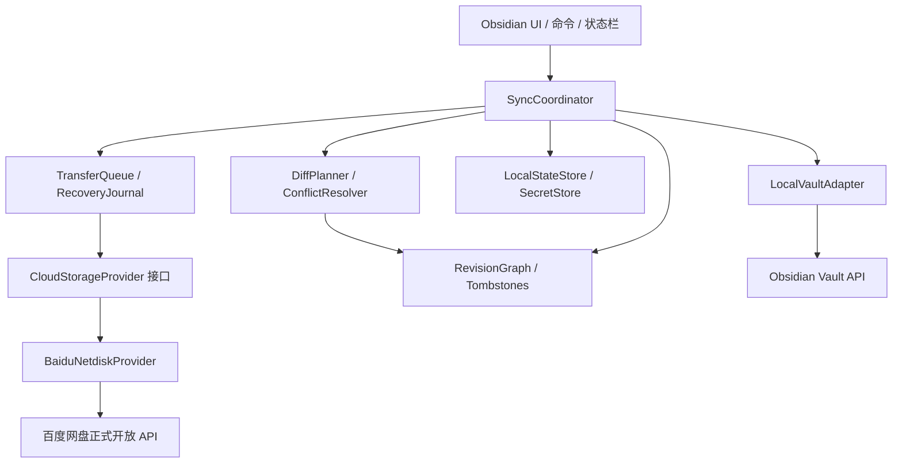
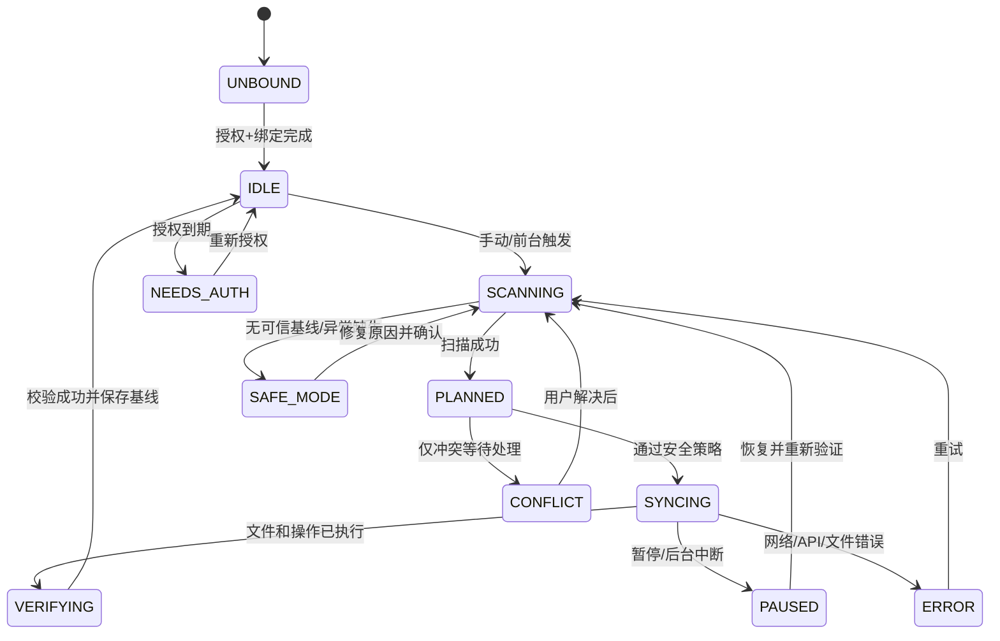

# VaultSail — 多云 Obsidian 同步插件

> **产品需求文档（PRD）+ 技术设计基线 + 研发计划 + 验收清单**  
> 文档版本：v1.0 Draft｜日期：2026-10-14｜状态：**先完成百度 API 准入验证，再正式进入开发**  
> 目标：独立开发一款无需自建服务器、优先支持 Windows / iPad、支持多个 Vault 独立管理、可恢复且可审计的 Obsidian 同步插件。


> **范围更新（2026-10-14）**：正式产品定位为 **多云 Obsidian 同步插件**。百度网盘仅为第一期 Provider，不构成系统的唯一依赖。后续目标包括 OneDrive、WebDAV、S3、Google Drive。所有百度限定的需求、D0 检查和 API 验证均属于第一期适配器要求。同步引擎必须依赖能力驱动的 `CloudStorageProvider` 接口。当前不支持一个 Vault 同时向多个云端写入。详见 [`MULTI_CLOUD_ARCHITECTURE.md`](MULTI_CLOUD_ARCHITECTURE.md)。

## 0. 先看结论：立项决策

### 0.1 决策摘要

- **开发方式**：从零新建 TypeScript Obsidian 插件；研究现有开源项目的业务思路、使用官方示例工程作为初始化模板；不直接依赖参考仓库的架构和同步正确性。
- **核心产品承诺**：不静默覆盖、不会把首次绑定时缺失的本地/云端文件直接判为删除；同步前可预览、冲突有副本、错误可追踪。
- **核心场景**：Windows 的科研知识库 `AI-Research` 与 iPad 上命名不同的本地 Vault 绑定同一个远程 Vault；另外的个人 Vault、工作 Vault 各自绑定其他远程 ID，互不串库。
- **首个交付**：支持 **手动上传/下载 + 云端 Vault 绑定 + 文件完整性校验** 的可用原型；之后才做双向自动同步。
- **关键阻塞**：百度网盘开放平台的**开发者准入、应用审核、OAuth 授权、上传/下载/列目录/删除权限、速率与费用**必须以当前账号的真实接口测试结果为准。开放平台的新旧资料可能不一致，本文不保证旧版 `xpan`/`pcs` 端点对新账号仍可调用。
- **安全默认值**：第一次绑定只预览不写入；首次启用删除传播关闭；有不确定性时停止破坏性操作；MVP 不宣称端到端加密。

### 0.2 Go / No-Go 技术门槛（D0）

下面任一 **P0** 项无法通过，就先暂停百度网盘适配，保留通用存储抽象，不得冒进到双向同步。

| 编号 | 检查项 | 验证方法 | 通过条件 | 未通过处理 |
|---|---|---|---|---|
| G-01 | 申请与授权资格 | 以拟使用的个人/企业主体创建应用 | 有合规、可长期使用的 App 凭据和明确权限 | No-Go；调研正式接入或更换存储后端 |
| G-02 | OAuth 授权与刷新 | Windows 与 iPad 实机授权；令牌过期后刷新 | 无需泄露 App Secret，刷新可靠或有安全重授权方案 | 修改授权方案，不能硬编码密钥 |
| G-03 | 文件列举与增量元数据 | 枚举包含多级目录/数百文件的测试目录 | 能列全、分页稳定、有足够识别字段 | 重新设计存储索引与扫描策略 |
| G-04 | 上传 / 下载 / 校验 | 1KB、4MB、20MB 的文本与二进制文件往返 | 数据字节完全一致；失败可重试 | 无法通过则暂停同步引擎 |
| G-05 | 应用数据目录与权限 | 验证目录创建、覆盖、下载、重命名、删除 | 有正式文档或实际响应记录证明 | 缩小功能范围，不假设可删除 |
| G-06 | iPad 网络兼容 | iPad 上使用 `requestUrl` 调用真实 API | 可授权、下载、上传，前后台切换不损坏数据 | 若移动端不通，不标注 iPad 已支持 |
| G-07 | 限流/配额/费用 | 用真实账号做小规模负载测试 | 明确速率、失败码、调用限制与潜在成本 | 产品显式限制，不宣称永久免费 |

**D0 输出物**：`docs/feasibility.md`、`docs/baidu-api-matrix.md`、脱敏请求响应、Windows/iPad PoC 截图、Go/No-Go 结论。  
**注意**：百度网盘会员 ≠ 开放 API 授权。第三方开源项目可运行 ≠ 你的新应用一定获得同等权限。

---

## 1. 产品概述

### 1.1 背景与痛点

使用 Obsidian 记录 Markdown 笔记、阅读材料、论文摘要、PDF 附件、图片及插件配置，通常有如下问题：

1. Windows 和 iPad 端的本地 Vault 名称或路径不相同，现成同步方案不容易正确映射。
2. 希望使用已有的百度网盘容量而非再订阅一个新的同步服务。
3. 用户可能有多个 Vault（科研、个人、工作），不能相互覆盖，也不应把一个 Vault 的删除传播到另一个 Vault。
4. 离线编辑、网络中断、同时修改、文件重命名等情况下，简单的“以较新的修改时间覆盖”可能造成数据丢失。
5. 希望可以查看同步计划、执行日志、冲突原因，遇到问题时可以恢复。
6. iPad 端插件运行生命周期由系统决定，不能把“锁屏后持续后台同步”作为可靠承诺。

### 1.2 产品定位

VaultSail 是安装于各个 Obsidian Vault 内的社区插件，以百度网盘作为首个云端数据提供方，在**不自建服务器**的前提下提供多设备同步。插件为每个本地 Vault 配置单独的 `remoteVaultId`，采用差异扫描与受保护的双向同步；第二阶段引入多端因果版本与不可变操作记录，避免并发写入覆盖同步元数据。

### 1.3 目标用户

| 用户类型 | 需求 | 本期支持 |
|---|---|---|
| 单人多设备用户（主目标） | Windows / iPad 在不同网络间同步 Markdown、PDF、图片 | 是 |
| 多知识库用户（主目标） | 科研/个人/工作等 Vault 独立同步 | 是 |
| 重视安全的用户 | 有冲突保留副本、误删回收与恢复 | 是 |
| 多人协同编辑团队 | 实时多人协作、精细权限管理 | 否，1.x 不承诺 |
| 超大媒体库用户 | 视频、GB 级大附件、长时间后台任务 | 非首期 |

### 1.4 产品目标（G）

- **G1**：两台设备在同一远程 Vault 下最终得到相同且完整的文件内容，遇到冲突时保留所有有效分支。
- **G2**：多个本地 Vault 可以分别绑定到远程 Vault，名称可不同，且互不污染。
- **G3**：用户知道“同步了什么、为什么、失败了哪里”，可先预览后执行。
- **G4**：断网、崩溃、被系统挂起、令牌过期后安全恢复，默认不做不可逆删除。
- **G5**：架构允许未来增加 WebDAV / OneDrive 等 Provider，但不在首期同时实现。

### 1.5 非目标（Non-goals）

- 不做在线文档编辑器、笔记内容搜索、多人协同光标、账号系统或自建同步服务器。
- 不保证 iPad 锁屏后持续定时运行；只保证 App 活跃时可触发同步和可靠恢复。
- 不自动合并 Markdown 段落或 YAML 字段；冲突保留双份，人工决定。
- 不同步其他 App 的私有数据；不扫描 Vault 外部目录。
- 1.0 前不做商业化、跨账号分享、多人授权管理。
- 不将百度网盘普通会员速度、免费额度或第三方旧版 API 能力视为产品 SLA。

### 1.6 产品原则

1. **数据完整性 > 正确性 > 可解释性 > 速度 > 极简交互**。
2. 无法确认同步基准时，不传播删除、不覆盖现有文件。
3. 首次同步不视为普通增量同步，必须明确建立基线。
4. 云端操作具备可重试性/幂等性；执行结果可验证。
5. 默认最小权限，默认不上传凭据、日志中的敏感正文或隐私密钥。

---

## 2. 范围、优先级与版本

### 2.1 需求优先级定义

- **P0 / 必须**：没有它不能称为安全可用；必须在相应版本验收。
- **P1 / 应该**：提高使用效率与可恢复性；根据里程碑交付。
- **P2 / 可选**：体验增强，不阻塞核心目标。

### 2.2 版本边界

| 版本 | 关键能力 | 不包含 | 出口条件 |
|---|---|---|---|
| D0（预研） | 百度 API 准入、PoC、双端可用性核验 | 正式双向同步 | G-01～G-07 通过 |
| V0.1（备份原型） | 创建/绑定远程 Vault、列表、手动上传/下载、校验、操作预览 | 自动删除、真正双向冲突判断 | 100 个文件往返无损 |
| V0.2（双向安全版） | 基线、三方差异、增量同步、离线恢复、冲突副本、删除隔离 | 加密、云端自动清理 | 并发冲突/断网测试通过 |
| V0.3（多 Vault 与 iPad） | 远程 Vault 管理、多端配对、iPad 手动/打开时同步、排除规则 | iOS 持续后台同步 | 2 Vault×2 设备不串库 |
| V0.4（可恢复版） | 历史、日志、失败重试、导出诊断、容量和限速保护 | 云端自动永久清理 | 故障注入及回滚演练通过 |
| V1.0（稳定版） | 发布审核、文档、成熟测试、可选安全加密方案经专项审计后上线 | 实时协作 | 通过发布验收矩阵 |

**建议**：V1.0 可先发布“可靠同步、无端到端加密”的明确版本；E2EE 是独立的安全里程碑，**不能为赶发布时间牺牲安全审计**。

---

## 3. 使用场景与用户故事

| ID | 用户故事 | 优先级 | 验收要点 |
|---|---|---|---|
| US-01 | 作为首次用户，我能完成百度账户连接并确认权限 | P0 | 成功/失败状态明确；Token 不写到明文日志 |
| US-02 | 我能创建远程 `research` 知识库并绑定当前本地 Vault | P0 | 远端生成不可变 UUID，显示名称可修改 |
| US-03 | 我的 Windows `AI-Research` 与 iPad `Research` 能绑定同一个远程 Vault | P0 | 不强制本地名字一致；绑定需要确认 |
| US-04 | 我第一次同步时先看到上传、下载、冲突清单 | P0 | 预览模式默认打开；未确认不执行高风险动作 |
| US-05 | 我离线写完笔记后，联网即可手动完成同步 | P0 | 本地修改可保留，失败项可重试 |
| US-06 | 两端修改同一笔记，我希望两份内容都保留 | P0 | 原笔记与冲突副本可查看；无静默 LWW |
| US-07 | 我误删笔记，另一端不应立刻永久删除 | P0 | 删除进入待确认或回收路径；支持恢复 |
| US-08 | 我可以排除 `.obsidian/workspace*.json` 等设备差异文件 | P0 | 默认排除、可视化编辑与预览 |
| US-09 | 我可以查看本次同步新增/修改/删除/冲突数与耗时 | P1 | 提供可读摘要和结构化日志 |
| US-10 | iPad 被切后台后再次打开，任务能安全恢复 | P0 | 不出现半文件/无基准覆盖；可重试 |
| US-11 | 一个设备解绑，不影响其他设备及云端笔记 | P0 | 解绑不自动删除云端数据 |
| US-12 | 更换 iPad 后能重新授权并选中原远程 Vault | P1 | 安全重新绑定；无需暴露长期 Secret |
| US-13 | 我想同步图片/PDF 等非 Markdown 附件 | P0 | 二进制完全一致；不进行文本编码转换 |
| US-14 | 我能查看冲突历史并手工选择保留哪一版 | P1 | 不删除未选版本，支持手动归档 |
| US-15 | 我切换科研 Vault 到个人 Vault，彼此不能混用文件 | P0 | `remoteVaultId` 隔离及设备配置独立 |

### 3.1 典型流程 A：首次 Windows 配置

1. 在**专用测试 Vault** 中安装插件；打开“VaultSail”设置页。
2. 点击“检查百度开发者接入状态”；完成 OAuth 或按当前开放平台允许的合规授权方式登录。
3. 点击“测试连接”验证令牌、云端应用目录、读/写/列举能力。
4. 选择“创建远程知识库”，填写显示名称 `research`；远端分配 `vault_...` 稳定 ID。
5. 选择 `首次同步模式 = 预览并建立基线`；显示上传、下载及潜在冲突。
6. 用户确认后启动；先上传数据和校验，再发布远端变更；结束后显示摘要。
7. 首次完成前**不传播删除**。

### 3.2 典型流程 B：iPad 绑定已有远程 Vault

1. iPad 新建名为 `Research` 的本地 Obsidian Vault，安装插件。
2. 使用该设备支持的 OAuth/授权方式连接同一百度账户；不要求 Vault 名相同。
3. 从云端列表选择已有 `research`，显示远端 ID 和文件数量，确认绑定。
4. 进入“首次拉取预览”：默认 **优先保留本地已有文件**；同名且内容不同的文件先进入冲突处理。
5. 下载、校验并应用；App 活跃时提供同步命令及“启动后检查”。
6. 设备进入后台时尽可能停止发新请求，回前台恢复 pending 事务。

### 3.3 典型流程 C：两端同时修改

- A、B 两端均从文件版本 R1 出发，离线修改生成 A2、B2。
- A2、B2 都成功上传并被发现后，系统判断它们**不是单条祖先链上的先后更新，而是分叉版本**。
- 不以设备墙上时间自动决定获胜；主视图保留本地版本，并生成 `文件名 (conflict-设备-时间).md`（实际命名需去重）；同步状态标记 `conflict`。
- 用户手工合并后提交新版本 R3，并在冲突 UI 标记已解决；A2、B2 保留在历史中直至达到明确清理策略。

### 3.4 典型流程 D：误删除

- A 删除 `note.md`，产生 tombstone（删除意图），**不立即清理远程 blob**。
- B 如果基于旧版本修改了该文件，视为“修改 vs 删除”的冲突，双方保留。
- 如果 B 没有新修改，则根据策略进入本地回收站，用户可以恢复。
- 首次绑定、缺乏可信同步基线、远端目录读取不完整时，**禁止把“文件缺失”解释为删除**。

---

## 4. 功能需求详述

### FR-01 百度账户与授权（P0，D0/V0.1）

**输入**：当前支持的 OAuth 授权方式、应用凭证（如适用）。  
**处理**：启动授权 → 获取 Access Token → 查询身份/权限 → 安全保存 → 到期刷新或安全重授权。  
**输出**：连接状态、账号标识脱敏显示、能力自检结果。

**交互与规则**：
- 设置页显示“未授权 / 已授权 / 即将过期 / 需要重新授权 / 接口未开通”。
- 不在源码中硬编码可滥用的 `client_secret`；纯客户端架构若被要求保密式客户端密钥，应优先采用平台允许的 PKCE / 设备授权 / BYO 客户端流程；否则必须重新评估服务端 token broker，而不能伪装机密安全。
- 优先使用 Obsidian 官方 `SecretStorage` 管理密钥（需核验支持的最低 Obsidian 版本）；不把 access/refresh token 直接写到普通 `data.json`、配对码日志或云端。
- 导出调试信息必须清除凭证、账号隐私和下载直链中的敏感参数。
- API 返回权限缺失、审核未通过、限流、令牌失效时必须显示不同错误类别。

**验收**：无密钥泄露；令牌失效后能够重新连接；端点未授权时禁用同步。

### FR-02 云端 Vault 管理与绑定（P0，V0.1/V0.3）

**关键约束**：Obsidian 插件运行于当前打开的 Vault 上；**一个插件实例只操作一个本地 Vault**。所谓“多 Vault”是多个本地 Vault 各自绑定不同或相同远程 Vault，**不是一个插件实例直接打开系统中全部 Vault**。

- 创建、列出、重命名（仅 displayName）、绑定、解绑远程 Vault。
- 远程 Vault 唯一标识 `remoteVaultId` 一经创建不因显示名变化而变化。
- 当前 Vault 已绑定时切换远端必须显示源/目标文件差异与风险，并重新建立基线。
- 默认禁止“删除远程 Vault”；如以后加入，必须二次确认和恢复路径说明。
- 多端共享同一 Vault 需验证远端 ID、账号身份、schemaVersion；不自动按本地目录名称推断。
- 插件本地状态必须绑定 `remoteVaultId`，不能把 A Vault 的 cursor/基线复用给 B。

### FR-03 文件范围与过滤（P0，V0.1/V0.3）

- 默认包含 `*.md`、图片（png/jpg/webp/svg）、PDF、常见轻量附件；支持按扩展名开启其他类型。
- 默认排除 `.git/`、`node_modules/`、`.trash/`、插件自身数据与恢复缓存、系统临时文件、`workspace*.json`、设备特定缓存。
- `.obsidian/` **整体默认不上传**；后续以白名单单独启用主题、CSS snippets、特定插件配置，避免设置循环、跨设备不兼容和密钥泄露。
- 用户可编辑 include/exclude glob 规则，并在“预览筛选结果”界面列出符合规则的文件。
- 符号链接、非法路径、`../`、绝对路径、保留设备名、大小写冲突要拒绝或隔离；路径一律在 Vault 根内规范化。
- 对目录重命名、Unicode 规范化、大小写敏感性不同的设备，保证路径冲突不会静默覆盖。
- 文件大小阈值初始建议 100 MiB **仅为产品默认配置候选值**；平台允许值与 iPad 运行内存由 PoC 决定。

### FR-04 本地/远端扫描与差异预览（P0，V0.1/V0.2）

- 获取文件路径、尺寸、修改时间及摘要；**mtime 仅作优化线索，不能独立判断内容一致**。
- 内容完整性标识使用 SHA-256；若百度上传接口要求 MD5 分片摘要，MD5 **仅用于协议适配**，不作为安全完整性判断。
- 基于本地/上次共同基线/远端版本进行三方比较。
- 操作计划分类：`UPLOAD`、`DOWNLOAD`、`NOOP`、`LOCAL_DELETE`、`REMOTE_DELETE`、`CONFLICT`、`SKIP`、`BLOCKED`。
- 列表显示路径、动作、原因、数据大小及风险；首次绑定、文件大量变化和危险动作必须确认。
- 扫描不完整、游标不可信或远端列目录失败时**不得生成可执行删除计划**。

### FR-05 上传与下载（P0，V0.1）

- 对二进制文件采用 `ArrayBuffer` 路径，避免文本转换污染 PDF / 图片。
- 上传先完成分片（如需要）→ 组合确认 → 服务端元数据校验 → 发布版本事件；严禁在 blob 未成功存储时宣告同步完成。
- 下载时先校验尺寸与 SHA-256，再应用至目标；替换已有文件前保存可恢复版本；异常不应留下半写入内容。
- 请求超时/网络中断时重试；重试应具备幂等键或通过远端对象标识验证。
- 对同路径不同 Hash 不直接覆盖；交由冲突策略。
- 下载的云端响应字段、签名链接过期与重定向按照实际 API 实现；不硬编码文档未确认的端点。

### FR-06 双向同步引擎（P0，V0.2）

- 采用**三方基线 + 文件版本 ancestry（祖先关系）**判断单边修改、同向修改及并发分叉。
- 计划执行必须经过：扫描 → 校验 → 规划 → 预览/防护 → 传输 → 提交远端事件 → 应用本地 → 持久化基线 → 验证。
- 启动时先恢复未完成任务，再扫描；同一 Vault 同一时间只允许一个 SyncSession 执行。
- 本地写入文件引发的 Obsidian 事件要用内部操作标签/防抖过滤，避免无限循环。
- 各设备独立写入不可变提交/事件，不共享一个需要并发覆盖更新的单一 `manifest.json` 作为唯一真相。
- **正确性边界**：没有服务端 CAS、事务或线性一致性保证时，不宣称强一致；以“最终发现操作事件 + 不丢失有效文件版本 + 可恢复”为目标，并通过真实 API 验证列表可见性与重复操作。

### FR-07 冲突处理（P0，V0.2）

**冲突定义**：两个有效变更的 base revision 相同或无祖先关系，或“修改与删除”并发发生。

- 文本冲突：保留本地原件、生成唯一冲突副本，列出两个版本的 Hash、来源设备、编辑时间（仅供参考）和版本 ID。
- 二进制冲突：保留两个文件副本；不尝试文本合并。
- 同名/大小写冲突：阻断危险覆盖并提示手工重命名。
- 提供“保留本地”“保留云端”“两份都保留”“稍后处理”，默认“两份都保留”。
- 冲突解决必须产生一个合并版本及其父版本引用，后续同步不重复弹出已解决冲突。
- 所有自动命名都要处理重复冲突文件名和移动端不合法字符。

### FR-08 删除传播与防误删（P0，V0.2/V0.4）

- 首次绑定 **无删除传播**；只有已经建立可信共同基线的文件才可识别删除。
- 删除以 `tombstone` 表达，保留最后有效版本的引用；云端实际内容不立即物理清除。
- 应用到本地时优先使用 Obsidian 文件回收能力；不同平台的回收语义须实测，失败则禁止删除。
- **删除防护阈值**：默认一次删除超过 `10 个文件或扫描总量 10%`（任一达到）需二次确认；阈值为产品默认建议值，可配置，但不允许关闭“无基线不得删除”。
- 批量删除、整目录变空、换账号、目录列表分页缺失、权限不足：自动进入 `SAFE_MODE`。
- 云端垃圾回收/永久删除功能默认关闭，V1.0 前无自动物理删除。

### FR-09 同步触发与任务管理（P1，V0.2/V0.3）

- 手动按钮、命令面板、状态栏图标是 P0。
- 桌面端：可选启动后检查、每 N 分钟活动态轮询、保存后防抖触发（例如 5–15 秒，实际可配置）。
- iPad：前台打开 Vault 后检查、手动触发、回前台恢复；**不承诺系统后台挂起时继续同步**。
- `Pause` 允许当前最小传输单元完成后停止；`Cancel` 标记可重试而非删除中间状态。
- 遇到 429/服务端限额指数退避（带 jitter），遇到 401/权限错误暂停并提示。
- 同步成功显示“上次成功时间”；失败显示“需要处理”，不能仅展示旋转图标。

### FR-10 配置迁移与多设备配对（P1，V0.3）

- 首选 **各设备自行授权**并选择相同远程 Vault；提供复制 `remoteVaultId` 的无敏感配对信息。
- 不在二维码或普通配置导出中携带 Access/Refresh Token、App Secret、加密主密钥。
- 如后续确需迁移敏感授权，必须设计单独的端到端加密配对流程、短期时效、防重放及安全评审，默认关闭。
- 绑定前确认账号身份与远端 Vault UUID，避免同名误绑定。

### FR-11 日志、历史与恢复（P1，V0.4）

- 日志事件：扫描摘要、计划摘要、开始/完成/失败、HTTP 错误分类、冲突和恢复状态，不记录笔记正文及完整 Token。
- 每次 SyncSession 含 `sessionId`、设备 ID、远端 Vault ID、耗时、变更计数、失败计数和重试次数。
- 提供“导出已脱敏诊断包”“预览未完成任务”“重新验证远端基线”“恢复历史版本”。
- 历史保留策略按版本数量/空间阈值提示；MVP 不自动永久清理；启用后清理需考虑离线设备仍需读取历史。

### FR-12 加密与隐私（P1 安全专项，V1.x）

- 未启用 E2EE 时明确说明：百度云端可存放可读文件及路径元数据，不能称为零知识。
- E2EE 设计候选：随机数据密钥、AES-256-GCM（唯一 nonce）、基于强密码的 KDF、密钥轮换与恢复策略；加密范围必须覆盖**文件内容、文件名、目录结构或明确披露未加密的元数据**。
- 不把 MD5 视作密码学完整性保护；加密完整性由 AEAD 验证。
- 口令遗失后的恢复限制要明确告知；不能保存明文恢复口令。
- 上线前必须有独立安全审查、向量测试、跨端互操作测试、错误密码测试和故障恢复测试。

### FR-13 设置界面与国际化（P1，V0.3）

- 首期简体中文 UI；代码的 message key 结构支持未来英语。
- 危险选项旁显示实际影响，例如“启用删除同步”与“同步 `.obsidian` 配置”均需明显提醒。
- 用户可测试连接、预览规则、恢复默认安全值；重置数据需区分“本地同步基线”和“远程笔记数据”。

---

## 5. 页面与交互设计（文字线框）

### 5.1 信息架构

```text
VaultSail
├── 同步概览（Home）
│   ├── 当前 Vault / 远端 Vault / 百度账户
│   ├── 同步状态与上次成功时间
│   ├── [扫描差异] [开始同步] [暂停]
│   ├── 本次计划（上传/下载/冲突/删除）
│   └── 最近任务与异常
├── 远端 Vault（Vaults）
│   ├── 创建/绑定/重命名/解绑
│   └── 远端 Vault 信息与映射
├── 冲突中心（Conflicts）
│   ├── 未解决冲突
│   └── 查看版本 / 选择保留 / 标记已解决
├── 恢复中心（Recovery）
│   ├── 历史版本/回收/失败事务
│   └── 诊断日志
└── 设置（Settings）
    ├── 账户与权限
    ├── 同步触发
    ├── 文件过滤与大小
    ├── 安全/删除策略
    └── 关于/版本/隐私
```

### 5.2 页面 P01：首次使用向导

```text
┌──────────────────────────────────────────┐
│ VaultSail · 首次设置             1 / 4 │
│ 当前本地 Vault：AI-Research              │
│                                          │
│ [连接百度网盘]                            │
│ 状态：未授权                              │
│ 说明：需要经过开放平台授权校验             │
│                                          │
│ 下一步：选择 / 创建远程知识库              │
└──────────────────────────────────────────┘
```

分四步：授权 → 远端 Vault → 文件范围 → 首次扫描及确认。任何一步失败后可恢复继续，不允许静默“完成”。

### 5.3 页面 P02：同步概览

```text
┌──────────────────────────────────────────┐
│ VaultSail   ● 需要同步                 │
│ 本地：AI-Research   远端：research        │
│ 上次成功：2026-10-14 13:30               │
│                                          │
│ [扫描差异]   [同步]   [暂停]              │
│                                          │
│ 待上传 12  待下载 3  冲突 1  删除待确认 2 │
│ --------------------------------------- │
│ ↑ papers/notes.md       本地已修改       │
│ ↓ assets/chart.png      远端有新版本     │
│ ! ideas.md              双端冲突         │
│ × old.md                删除需确认       │
│                                          │
│ [查看完整计划]  [查看日志]                │
└──────────────────────────────────────────┘
```

### 5.4 页面 P03：绑定远程 Vault

- 显示 `displayName`、短 UUID、账号、文件数（如果能安全计算）、最近提交时间。
- 选中后弹窗：`当前本地 Vault 将绑定远程 research（id: rv_xxx），并不要求本地名称相同。首次执行将扫描差异，不会自动删除已有文件。`
- 变更绑定要输入确认词或按住确认；默认新建基线、先 dry-run。

### 5.5 页面 P04：同步预览

- 标签：全部、上传、下载、冲突、忽略、待确认删除。
- 每项展示：路径、变化来源、当前摘要、大小、执行动作、风险提示。
- 顶部支持 `仅预览`、`执行安全动作`；删除/覆盖有单独确认。
- 发生错误时按行显示“已完成/已跳过/待重试/冲突阻断”。

### 5.6 页面 P05：冲突中心

- 并排元信息：本地版本、云端版本、共同基线、关联父版本。
- 操作：打开本地、打开冲突副本、复制路径、保留两者、按用户确认的版本覆盖、稍后处理。
- 覆盖按钮必须显示将保留的历史版本；禁止未保存来源版本就覆盖。

### 5.7 UI 状态与文案

| 状态 | 图标/文案 | 点击行为 |
|---|---|---|
| `UNBOUND` | 未绑定远程知识库 | 打开绑定向导 |
| `IDLE` | 已同步 / 上次成功时间 | 扫描差异 |
| `SCANNING` | 正在检查变化 | 展示进度 |
| `SYNCING` | 正在同步 N/M 个文件 | 展示详情/暂停 |
| `PAUSED` | 已暂停，可继续 | 恢复或取消 |
| `NEEDS_AUTH` | 授权已失效 | 重新连接 |
| `CONFLICT` | N 个冲突待处理 | 打开冲突中心 |
| `SAFE_MODE` | 检测到潜在误删，已停止危险操作 | 查看风险清单 |
| `ERROR` | 同步失败，保留未完成操作 | 查看日志、重试 |

---

## 6. 技术架构

### 6.1 技术选型

| 层 | 技术 | 说明 |
|---|---|---|
| 语言 | TypeScript（strict） | 插件原生技术栈 |
| 构建 | Node.js LTS + esbuild | 采用官方 sample plugin 思路，构建时可用 Node，运行时不能依赖它 |
| 插件 API | Obsidian `Plugin` / `Vault` / `FileManager` / `DataAdapter` / `requestUrl` | 优先使用 `Vault` API；隐藏目录按能力受控使用 adapter |
| HTTP | Obsidian `requestUrl` | 跨端请求；大文件分片是否可行须 iPad PoC 验证 |
| 摘要 | Web Crypto SHA-256 + 兼容 MD5 实现（仅协议） | 二进制内容校验；检查内存成本 |
| 本地状态 | Plugin data + 合适的设备私有状态/安全凭证存储 | 设备 ID、队列、游标不能随笔记同步被覆盖 |
| 自动化测试 | Vitest/Jest（二选一）+ mock adapter + contract tests | 无需真的覆盖生产 Vault |
| 持续集成 | GitHub Actions | lint、typecheck、test、build、release |
| 服务端 | 不自建 | 百度网盘先行，接口提供方可替换 |

**移动端要求**：插件 `manifest` 应将 `isDesktopOnly` 设置为 `false`，但发布前需要真机证明适配；禁止在模块顶层引用 `fs/path/electron` 等 Node/Electron API。Obsidian 官方文档指出移动端 Adapter 可能是 `CapacitorAdapter` 而非 `FileSystemAdapter`。

### 6.2 组件图



### 6.3 推荐代码目录

```text
vaultbridge/
├── manifest.json
├── package.json
├── esbuild.config.mjs
├── src/
│   ├── main.ts
│   ├── app/SyncCoordinator.ts
│   ├── app/TaskQueue.ts
│   ├── domain/models.ts
│   ├── domain/SyncPlanner.ts
│   ├── domain/ConflictDetector.ts
│   ├── domain/VersionGraph.ts
│   ├── domain/SafetyPolicy.ts
│   ├── infrastructure/obsidian/LocalVaultAdapter.ts
│   ├── infrastructure/storage/CloudStorageProvider.ts
│   ├── infrastructure/storage/baidu/BaiduAuth.ts
│   ├── infrastructure/storage/baidu/BaiduApiClient.ts
│   ├── infrastructure/storage/baidu/BaiduProvider.ts
│   ├── infrastructure/state/LocalStateStore.ts
│   ├── infrastructure/state/RecoveryJournal.ts
│   ├── infrastructure/crypto/Hashing.ts
│   ├── ui/SettingsTab.ts
│   ├── ui/SyncView.ts
│   ├── ui/ConflictModal.ts
│   └── utils/paths.ts
├── tests/
│   ├── unit/
│   ├── integration/
│   ├── fixtures/
│   └── e2e-manual/
├── docs/
│   ├── feasibility.md
│   ├── api-contracts.md
│   ├── security.md
│   └── troubleshooting.md
└── .github/workflows/
```

### 6.4 关键 TypeScript 契约（示意）

```ts
export type CloudErrorCode =
  | 'AUTH_EXPIRED' | 'PERMISSION_DENIED' | 'RATE_LIMITED'
  | 'NOT_FOUND' | 'CONFLICT' | 'NETWORK' | 'QUOTA'
  | 'CORRUPTED' | 'UNSUPPORTED' | 'UNKNOWN';

export interface RemoteFileRef {
  id: string;              // 云端不变引用；可由 provider 映射
  etag?: string;
  size: number;
  sha256?: string;         // 若云端不返回，由客户端下载后校验
}

export interface CloudStorageProvider {
  capabilities(): Promise<ProviderCapabilities>;
  list(prefix: string, cursor?: string): Promise<{
    items: RemoteFileRef[];
    nextCursor?: string;
  }>;
  read(id: string): Promise<ArrayBuffer>;
  writeImmutable(key: string, body: ArrayBuffer): Promise<RemoteFileRef>;
  exists(key: string): Promise<boolean>;
  // delete/rename 不作为 SyncEngine 正确性的前置条件
}

export interface LocalVaultFile {
  path: string;
  size: number;
  mtime: number;
  sha256: string;
}

export type SyncAction =
  | 'UPLOAD' | 'DOWNLOAD' | 'NOOP' | 'CONFLICT'
  | 'TRASH_LOCAL' | 'TOMBSTONE_REMOTE' | 'SKIP' | 'BLOCKED';
```

注：接口仅是**内部领域抽象**，并非百度网盘官方 TypeScript SDK 或现成端点契约；实现前应在 D0 中确定真实 API 允许的幂等写入和文件读取能力。

---

## 7. 云端数据模型与多设备一致性

### 7.1 核心设计判断

**不要把“所有设备共同覆盖一个 manifest.json”作为唯一真相**。如果 A、B 同时下载到版本 10，分别写出版本 11A、11B，且百度 API 没有条件写入（CAS），后写的一方可能直接覆盖另一方的信息。

建议使用**不可变版本对象 + 各设备不可变操作事件**：每个设备以随机 UUID 命名提交，永不覆写其他设备事件；通过列举/重放重建最新版本图。此方案更容易保护并发更新，但会增加远端文件数与扫描成本；V0.1 可采用受限的单写入者 PoC，V0.2 双向上线前必须完成不可变事件方案及规模测试。

### 7.2 建议远端目录（示意，实际根目录由平台许可决定）

```text
<百度应用被允许的目录>/vaultbridge/
├── registry/
│   └── vaults/                         # 每个远端 Vault 的不可变注册记录
│       ├── rv_ab12...json
│       └── rv_cd34...json
└── vaults/
    └── rv_ab12.../
        ├── metadata/
        │   └── vault.json               # 只保存创建元信息；非唯一提交真相
        ├── blobs/
        │   └── sha256-prefix/full-sha256 # 内容寻址对象（不变）
        ├── ops/
        │   └── device-uuid/
        │       ├── 000000000001-<uuid>.json
        │       └── 000000000002-<uuid>.json
        └── snapshots/                   # 性能优化；可从 ops 重建，不是唯一真相
```

> 部分百度历史 API 仅允许写入 `/apps/<应用名>/...`，新开放平台可能使用不同授权目录。该路径**只是假设示意**，必须以 D0 实测为准。

### 7.3 对象模型

| 实体 | 字段 | 含义 |
|---|---|---|
| `RemoteVault` | `vaultId`, `displayName`, `createdAt`, `schemaVersion` | 稳定远端库标识 |
| `Device` | `deviceId`, `label`, `firstSeen`, `lastSeen` | 每台设备的私有身份；不能随 `.obsidian` 被同步复制 |
| `FileRevision` | `revisionId`, `fileId`, `path`, `blobHash`, `parents[]`, `createdBy`, `kind` | 内容或删除版本；同一文件可有多个 head |
| `SyncOperation` | `opId`, `deviceId`, `seq`, `revision`, `schemaVersion` | 不可变发布事件，唯一且幂等 |
| `SyncBaseline` | `remoteVaultId`, `fileId`, `appliedRevisionIds[]`, `lastVerifiedHash` | 本地已确认共同基线 |
| `TransferTask` | `taskId`, `status`, `attempts`, `objectHash`, `localPath` | 可恢复队列任务 |
| `ConflictRecord` | `fileId`, `revisionHeads[]`, `localCopies[]`, `resolvedAt` | 待用户处理的分叉版本 |

### 7.4 示例操作事件

```json
{
  "schemaVersion": 1,
  "opId": "deviceA-000014-6dd5b47c",
  "vaultId": "rv_ab12cdef",
  "deviceId": "deviceA",
  "sequence": 14,
  "fileId": "file_0472",
  "revision": {
    "revisionId": "rev_e66df",
    "parents": ["rev_a118"],
    "path": "papers/reading.md",
    "kind": "update",
    "blobHash": "sha256-<hex-value>",
    "byteSize": 4738
  },
  "createdAtClient": "2026-10-14T08:00:00Z"
}
```

**不要用 `createdAtClient` 直接确定冲突胜者**。因果判定依据版本 parent 图；时间只用于 UI 显示和排序。示例中的 `<hex-value>` 为文档占位符。

### 7.5 同步提交协议

1. `SCAN_LOCAL`：读取文件目录及 Hash，并验证本地基线没有损坏。
2. `SCAN_REMOTE`：列举远端 ops 分页，获取所有可见事件；若分页不完整则报错，停止危险操作。
3. `BUILD_GRAPH`：根据 revisions/parents 构建各文件 head 集合。
4. `PLAN`：本地基线与远端 head 做三方比较；若互为并发分支，生成冲突动作。
5. `UPLOAD_BLOB`：先上传所需不可变内容对象，校验完成，不覆盖已有对象。
6. `PUBLISH_OP`：发布该设备唯一新操作事件，服务器确认可见后标记远端提交成功。
7. `APPLY_REMOTE`：下载并校验需要的远端内容，保存旧内容恢复点后应用。
8. `SAVE_BASELINE`：仅对已验证生效的变更更新本地基线。
9. `VERIFY`：扫描关键对象、验证本地 hash，完成 SyncSession。

**崩溃行为**：
- 如果上传了 blob 却未发布 op，blob 是孤儿对象，但不会使现有笔记被覆盖；可将来做垃圾回收。
- 如果发布 op 后本地尚未应用，重启时重新读取 op 并继续；依赖幂等 `opId` 去重。
- 如果本地应用到一半而崩溃，启动读取 RecoveryJournal，检测 Hash，保留源版本，然后继续或回滚。
- 如果远端列举出现最终一致性延迟，延迟重扫；不能因“没看见远端事件”就销毁本地更改。

### 7.6 正确性限制与规模控制

- 对**设备同时写入**而言，不可变 ops 避免直接覆写同一 manifest，但仍需要真实 API 证明目录列举最终可见、事件对象具唯一命名和完整写入语义。
- 发布操作的顺序可能乱序；重放时不依赖列出结果天然有序，依赖 `deviceId + sequence + opId` 去重、`parents` 判断祖先。
- 文件重命名通过稳定 `fileId` 表示路径变化；同路径两个不同 `fileId` 会触发路径冲突。
- 每个变更都创建事件可能导致对象过多：V0.4 后引入**只作为加速缓存**的 snapshot/segment 索引；删除旧 ops 需证明活跃/长期离线设备不会丢基线，初期不清理。
- 若平台禁止海量小文件或请求额度太低，评估追加式打包日志、单写入者限制或更换 Provider，不能牺牲可靠性假装完成。

### 7.7 本地持久化边界

| 类型 | 保存位置（设计方向） | 可跨设备同步？ |
|---|---|---|
| 普通展示偏好 | 当前插件设置 | 可选，需过滤私密字段 |
| `deviceId`、同步游标、重试队列、私有 baseline | 设备私有状态存储；实现时验证 Obsidian 生命周期与持久化能力 | **不可** |
| OAuth Token、App Secret、加密密钥 | Obsidian `SecretStorage` 或经安全评审的替代方案 | **不可直接** |
| 普通笔记及附件 | 当前 Obsidian Vault | 按规则同步 |
| 远端 Vault ID | 当前 Vault 的显式绑定配置 | 经验证可重新绑定 |

**特别警告**：不能把存放设备 ID/令牌的插件 `data.json` 作为 `.obsidian` 配置同步对象，否则可能导致不同设备拥有相同 `deviceId` 并相互污染同步状态。

---

## 8. 同步决策规则与状态机

### 8.1 三方比较矩阵

B = 本地上次**确认应用的版本**；L = 本地目前版本；R = 远端的版本图 head。

| 情况 | L 与 B | R 与 B | 处理 |
|---|---|---|---|
| 1 | 未变 | 未变 | NOOP |
| 2 | 改变 | 未变 | UPLOAD |
| 3 | 未变 | 改变 | DOWNLOAD |
| 4 | 相同内容改变 | 相同内容改变 | 哈希校验后合并基线/避免重复传输 |
| 5 | 改变 A | 改变 B，且互非祖先 | CONFLICT，保留双份 |
| 6 | 删除 | 未变 | 记录 tombstone；防护策略检查 |
| 7 | 未变 | 删除 | 安全移入本地回收站 |
| 8 | 删除 | 修改 | CONFLICT（删除 vs 修改） |
| 9 | 新建同路径 X | 新建同路径 Y | 哈希不同则冲突，不直接覆盖 |
| 10 | 无可信 B | 任意 | 首次基线流程：预览、不可执行删除 |
| 11 | 列表不完整 | 任意 | SAFE_MODE，禁止危险动作 |

**额外规则**：双方改名、改路径与内容变化要按稳定 `fileId` 统一判断，不能仅按路径匹配后“先删后建”。

### 8.2 状态机



### 8.3 并发控制

- 单设备：同一 Vault 保持单个活动 SyncSession；新触发合并为下一次计划。
- 跨设备：允许并发**只写不可变对象**；共用快照更新采用新对象，不覆盖其他设备数据。
- 网络重试：同 `opId` 重试，不可重复创建多个有效历史分支。
- 冲突：没有祖先关系的两个 head 同时保留，不自动选最新时间。

---

## 9. 百度网盘 API 与第三方依赖计划

### 9.1 API 能力矩阵（D0 实测填写）

| 能力 | 产品使用位置 | 历史资料可参考 | 2026 实际可用状态 |
|---|---|---|---|
| 开发者注册/审核 | 授权前置 | 百度网盘开放平台 | **待验证** |
| OAuth 授权 / refresh | 登录/重连 | OAuth 2.0 | **待验证** |
| 获取用户身份 | 防误绑账号 | 用户信息能力 | **待验证** |
| 创建/列举目录 | 创建远程 Vault | 文件管理/列表 API | **待验证** |
| 文件预上传/分片/合并 | 传输 Blob | 历史 `precreate`、`superfile2`、`create` | **待验证** |
| 获取下载链接/内容 | 下载 | 旧版文件 API | **待验证** |
| 删除/回收站 | 后续恢复 | 文件管理 API | **待验证** |
| 分页/变更时间 | 远端扫描 | 文件列表能力 | **待验证** |
| 限流/配额/计费 | 性能和 UX | 协议、控制台 | **待验证** |

**严禁**把表中历史端点直接作为生产接口契约；每项需要记下请求方法、最新官方页面、授权 scope、响应结构、错误码、测试时间和账号类别。

### 9.2 错误分类与重试

| 错误类 | 例子 | 策略 |
|---|---|---|
| 身份错误 | Token 失效 | 刷新一次；失败暂停并重授权 |
| 权限错误 | 审核/Scope 不足 | 停止，不自动频繁重试 |
| 限流 | HTTP 429 或平台限额码 | 尊重 Retry-After / 指数退避 |
| 网络错误 | 超时/断开/临时 DNS | 有上限的指数退避；上传需幂等 |
| 云端对象不存在 | 原对象被删除/路径改变 | 重扫；有基线缺失时保护本地 |
| 数据损坏 | Hash 不一致 | 隔离下载对象，不应用，重试后报警 |
| 配额不足 | 空间不足 | 暂停新上传，不做危险清理 |
| API 结构变化 | 新版字段/权限变化 | 打断并记录脱敏响应；不得猜测 |

### 9.3 Provider 可替换原则

核心 SyncEngine 不得直接 import 百度授权逻辑，也不处理百度特有错误码；由 `BaiduNetdiskProvider` 转为统一 `CloudErrorCode`。今后增加 Provider 时只新增认证、对象列表、读写和能力说明，而同步决策、冲突、历史模块保持复用。

---

## 10. 安全、隐私与合规需求

### 10.1 主要威胁模型

| 威胁 | 风险级别 | 缓解措施 |
|---|---|---|
| Token 泄露 | 高 | SecretStorage、日志脱敏、不导出明文凭证 |
| Vault 误绑定 | 高 | 展示稳定远程 ID + 账号校验 + dry-run |
| 并发修改被覆盖 | 高 | 不可变事件 + 分支检测 + 冲突副本 |
| 误删传播 | 高 | 可信基线、tombstone、阈值保护、回收与恢复 |
| iPad 挂起造成中断 | 高 | 事务状态持久化、重启核验、幂等重试 |
| 路径穿越/非法文件名 | 高 | 路径规范化、根路径校验、合法性白名单 |
| 第三方插件配置上传了密钥 | 高 | `.obsidian` 默认排除，白名单加敏感字段检查 |
| 百度接口政策变化 | 高 | D0 准入、能力探测、错误分级、替换 Provider |
| 明文云端存储 | 中～高 | UI 告知；E2EE 单独专项 |
| 损坏附件被错误应用 | 高 | SHA-256 校验、先备份再替换 |

### 10.2 隐私声明要求

- 首次使用声明会将用户选择的笔记和附件传输到百度网盘。
- 明确说明云端是否加密，以及哪些元数据可能暴露。
- 默认不接入第三方分析 SDK，不采集笔记正文、不上传日志到开发者服务器。
- 用户可以撤销百度账户授权，并解绑当前 Vault；解绑不自动销毁云端文件。
- 开源仓库不包含任何真实 App Secret、Token、个人云盘文件。

### 10.3 配置同步安全规范

- `.obsidian/plugins/vaultbridge/` 的状态文件默认且强制排除（若存在）。
- 其他插件配置若含 `token`、`secret` 等字段，第一期不自动同步此类配置；后续采用经过审核的显式白名单，而非按关键字猜测就当作安全。
- 不支持在未经认证的配对码中搬运凭证；可只配对远程 Vault 的 ID，设备独立登录。

---

## 11. 非功能需求（NFR）

| ID | 类别 | 目标/验收条件 | 说明 |
|---|---|---|---|
| NFR-01 | 数据完整性 | 全部完成状态的文件本地 SHA-256 = 下载复算 Hash | 主验收指标 |
| NFR-02 | 幂等性 | 同一操作重试 3 次，不产生重复的有效版本事件 | 网络故障测试 |
| NFR-03 | 安全性 | 100 次随机中断/恢复测试无不可恢复的数据损失 | 限定测试集 |
| NFR-04 | 可用性 | 授权失败可恢复；无凭据泄露 | Win+iPad |
| NFR-05 | 性能 | 基准数据集：1000 份 Markdown + 100 附件，总量 200MB | 用于测量，不是无条件支持承诺 |
| NFR-06 | 性能 | 在指定网络环境里，二次无变化同步尽量低于 30 秒 | 指标待 D0 限流实测调整 |
| NFR-07 | UI | 长任务有可见进度、取消/暂停和日志 | 不冻结交互线程 |
| NFR-08 | 移动端 | iPad 前后台切换 20 次，无静默覆盖或损坏 | 实机验收 |
| NFR-09 | 兼容性 | Windows、iPadOS 当前受支持 Obsidian 稳定版 | 最低版本依 SecretStorage 等 API 核实 |
| NFR-10 | 可维护性 | 核心差异引擎和安全策略单测覆盖率目标 ≥ 90% | 覆盖率不替代故障注入 |
| NFR-11 | 资源使用 | 单个大文件分片传输，避免整份大附件常驻 iPad 内存 | 受 API 实际能力限制 |
| NFR-12 | 可解释性 | 每项操作有原因码，错误不只显示“失败” | 便于定位 |
| NFR-13 | 变更兼容 | 远端 schemaVersion 不认识时只读/停写并提示 | 防新旧插件互相破坏 |
| NFR-14 | 隐私 | 所有日志与诊断包移除敏感凭证及文件正文 | 自动测试 |

> 所有性能指标应以明确网络、文件数量、文件大小和账号类型实测；不应对外宣传为普遍 SLA。

---

## 12. 详细测试计划

### 12.1 测试环境

- `Win-A`：Windows 11 + Obsidian Stable + 测试 Vault A。
- `iPad-B`：iPadOS + Obsidian Stable + 测试 Vault B。
- `Win-C`：第二个测试 Vault（同一电脑也可）用于验证多 Vault 隔离。
- `Cloud-Test`：单独的百度测试应用目录和测试账号；**严禁**用真实科研主库进行早期测试。
- `MockProvider`：支持模拟 401/403/429/5xx、丢包、乱序、延迟可见、上传中断、并发提交。

### 12.2 测试用例矩阵

| ID | 场景 | 预期结果 | 优先级 |
|---|---|---|---|
| T-001 | 第一次连接成功 | 状态显示已授权及账号信息 | P0 |
| T-002 | 错误/过期令牌 | 停止同步，提供重授权 | P0 |
| T-003 | 上传空 Markdown | 两端可得到空文件，Hash 正确 | P0 |
| T-004 | 上传中文/Emoji 文件名 | 路径往返正确或明确阻断 | P0 |
| T-005 | 上传 4MB 边界大小 | 分片/合并成功且 Hash 一致 | P0 |
| T-006 | 上传 PDF / PNG | 字节完全一致 | P0 |
| T-007 | 重复上传相同 Hash | 不生成不必要的有效版本 | P0 |
| T-008 | 远端列表有多页 | 完整扫描，无漏文件 | P0 |
| T-009 | 本地单边修改 | 仅上传修改，其他不动 | P0 |
| T-010 | 远端单边修改 | 下载新版本，保存可恢复旧版本 | P0 |
| T-011 | 双端同改成相同内容 | 去重并收敛，不误报永久冲突 | P0 |
| T-012 | 双端不同内容并发修改 | 两版保留，产生冲突记录 | P0 |
| T-013 | 删除 vs 修改 | 修改内容保留，删除不强制获胜 | P0 |
| T-014 | 首次绑定本地为空，云端有文件 | 预览下载；不上传全库删除 | P0 |
| T-015 | 首次绑定云端为空，本地有文件 | 预览上传；不删除本地 | P0 |
| T-016 | 首次绑定同名不同内容 | 进入冲突流程，绝不直接覆盖 | P0 |
| T-017 | 从 Vault A 切换绑定到 Vault B | 清理/冻结旧基线并重新预览 | P0 |
| T-018 | 两个本地 Vault 分别绑定不同远端 | 无串库，无共享游标 | P0 |
| T-019 | 设备复制插件 data.json 导致 deviceId 相同 | 检测/隔离，不发布冲突事件 | P0 |
| T-020 | Win 与 iPad 本地 Vault 名不同 | 同远端 UUID 正常同步 | P0 |
| T-021 | 传输中 Wi-Fi 断开 | 任务保留，恢复后重试，数据无损 | P0 |
| T-022 | 发布 op 前插件崩溃 | 孤儿 blob 可存在，旧数据不变 | P0 |
| T-023 | 发布 op 后应用本地前崩溃 | 重启重放 op，幂等收敛 | P0 |
| T-024 | 下载校验失败 | 不覆盖现有文件，显示错误 | P0 |
| T-025 | 服务器 429 限流 | 指数退避，不疯狂重试 | P0 |
| T-026 | 服务器 403 没权限 | 中止并提示申请权限 | P0 |
| T-027 | 云盘容量不足 | 不删除旧版本腾空间，明确报错 | P0 |
| T-028 | 远端扫描缺页/超时 | SAFE_MODE、禁止执行删除 | P0 |
| T-029 | 同时删除 >10 个文件 | 触发危险操作确认 | P0 |
| T-030 | 路径 `../` 穿越 | 拒绝写入 Vault 外 | P0 |
| T-031 | Windows 大小写路径碰撞 | 标记冲突，不覆盖 | P0 |
| T-032 | 带 BOM/CRLF 的笔记 | 不私自标准化源文件内容 | P0 |
| T-033 | `.obsidian/workspace.json` | 默认不参与同步 | P0 |
| T-034 | 插件的 Token 配置文件 | 永不上传或写入日志 | P0 |
| T-035 | 远端旧 schemaVersion | 进入兼容或只读，不破坏 | P0 |
| T-036 | iPad 应用切后台/恢复 | 重新校验未完成任务，最终收敛 | P0 |
| T-037 | 文件重命名后再编辑 | 尽量按同一 fileId 跟踪；不丢内容 | P1 |
| T-038 | 同路径并发创建不同文件 | 保留副本并提示 | P0 |
| T-039 | 同一操作重复回放 | 只形成一个有效变更 | P0 |
| T-040 | 脱敏导出诊断包 | 不出现 Access Token、文件正文 | P0 |
| T-041 | 新增 1000 文件性能测试 | 实际耗时与调用量记录 | P1 |
| T-042 | 旧设备离线 30 天后恢复 | 不因历史清理产生不可恢复丢失 | P1 |
| T-043 | 两设备同时提交不同 op | 两条事件最终可见 | P0 |
| T-044 | 删除后从回收站恢复 | 恢复后新版本可再次同步 | P1 |
| T-045 | E2EE 错误密码/损坏密文 | 不解密、不应用、不破坏旧文件 | V1.x |

### 12.3 故障注入与发布门槛

- 用 MockProvider 随机在 `UPLOAD_BLOB`、`PUBLISH_OP`、`APPLY_REMOTE`、`SAVE_BASELINE` 的每个边界中断 100 次，检查从未丢失最后一份有效版本。
- 使用 2 台设备对同一文件交替/同时编辑至少 50 轮，确保版本图最终收敛且冲突可解释。
- 以 iPad 实机验证长 PDF / 大附件传输内存边界，记录是否发生系统杀进程。
- 每次发布执行全量单测、集成测试、两设备冒烟测试；发现 P0 级数据破坏缺陷立即停止发布。

---

## 13. 项目计划、工期与任务拆分

### 13.1 工作量预估

假设：单人开发，有 TypeScript/JavaScript 基础，平均**每周 12–15 小时**，测试账号和设备已具备。这里给的是工作量估计，不是交付承诺。百度审核等待时间、API 政策变化与真实机型兼容问题不包含在内。

| 阶段 | 工作项 | 工作量（人时） | 依赖 | 阶段验收 |
|---|---|---:|---|---|
| D0 | 开放平台准入、OAuth/文件 PoC、iPad 网络测试 | 12–20 | 官方授权与账号 | Go/No-Go 已签字 |
| Sprint 1 | 项目骨架、设置、Provider 契约、测试框架 | 12–18 | D0 | 插件双端加载、CI 全绿 |
| Sprint 2 | 云端 Vault 创建/绑定、上传/下载、Hash 校验 | 18–26 | Sprint 1 | V0.1 |
| Sprint 3 | 差异扫描、可信基线、预览、过滤、安全策略 | 16–24 | V0.1 | 首次绑定不误删 |
| Sprint 4 | 不可变 ops、三方比较、并发冲突、tombstone | 28–40 | Sprint 3 | V0.2 |
| Sprint 5 | iPad 生命周期、跨端绑定、多 Vault 隔离 | 16–28 | V0.2 | V0.3 |
| Sprint 6 | 恢复日志、性能优化、故障注入、安全测试 | 20–30 | V0.3 | V0.4 |
| Sprint 7 | 用户文档、发布包、真机回归、发布审核 | 12–20 | V0.4 | V1.0 候选版 |
| **总计** | **基础稳定版（不包含 E2EE 专项）** | **134–206 人时** | **以通过 D0 为前提** | **约 9–17 个每周 12–15 小时的开发周** |

> 进度不应只按照编码时间估算；如果开发者资质申请/接口授权失败，排期会暂停。E2EE 需另行估算（建议增加独立设计、测试与审查任务）。

### 13.2 推荐每周迭代安排（可按实际速度拉伸）

| 周期 | 核心交付 | 可演示效果 |
|---|---|---|
| 第 1 周 | D0：完成百度准入和授权 PoC | 用真实账号列目录、上传、下载测试文件 |
| 第 2 周 | 工程骨架与 Provider | Obsidian 中可打开设置并运行 MockProvider |
| 第 3–4 周 | V0.1 | Windows 测试 Vault 可手动上传/下载，iPad 验证基本请求 |
| 第 5–6 周 | 差异、安全基线、事件协议 | 能预览双向变更，不会误删 |
| 第 7–9 周 | V0.2 | 双向同步；并发冲突保留副本 |
| 第 10–11 周 | V0.3 | Windows/iPad 同步两个独立远端 Vault |
| 第 12–13 周 | V0.4 | 断网/挂起/恢复及历史可追踪 |
| 第 14 周以后 | 回归与 1.0 试用发布 | 在专用测试/副本 Vault 运行稳定 |

此表为**顺序模板而非严格保证**；若每周投入约 8 小时，整体周期会相应拉长。

### 13.3 可直接转 GitHub Issues 的任务清单

#### Milestone D0 — API Feasibility

- [ ] `D0-01` 明确开发者身份和开放平台当前准入条件（P0）
- [ ] `D0-02` 创建测试应用，记录授权 Scope 与回调方式（P0）
- [ ] `D0-03` Windows OAuth / 重授权 PoC（P0）
- [ ] `D0-04` iPad OAuth / 真实 HTTP PoC（P0）
- [ ] `D0-05` 列表、分页、创建目录、上传、下载与 Hash PoC（P0）
- [ ] `D0-06` 研究 401/403/429、配额、速度、协议限制（P0）
- [ ] `D0-07` 发布 Go/No-Go 结论与脱敏接口矩阵（P0）

#### Milestone V0.1 — First Transfer

- [ ] `M1-01` 基于官方 Obsidian sample plugin 新建仓库（P0）
- [ ] `M1-02` TS strict、ESLint、格式化、CI、发布包（P0）
- [ ] `M1-03` 定义 `CloudStorageProvider` + `MockProvider`（P0）
- [ ] `M1-04` 实现 Baidu API Client / 认证（P0）
- [ ] `M1-05` 实现本地 Vault 文件枚举、读取、写入（P0）
- [ ] `M1-06` 云端 Vault 创建、列举、绑定（P0）
- [ ] `M1-07` SHA-256、上传/下载及重试（P0）
- [ ] `M1-08` 设置界面与手动命令（P0）
- [ ] `M1-09` 100 文件无损往返验收（P0）

#### Milestone V0.2 — Safe Sync

- [ ] `M2-01` 本地不可共享设备 ID、基线模型（P0）
- [ ] `M2-02` 本地/远端三方扫描与预览（P0）
- [ ] `M2-03` 版本父节点关系、不可变事件存储（P0）
- [ ] `M2-04` 文件修改与重命名决策（P0）
- [ ] `M2-05` 并发编辑冲突识别与副本（P0）
- [ ] `M2-06` tombstone 与删除阈值、安全模式（P0）
- [ ] `M2-07` 任务幂等、崩溃恢复、重试（P0）
- [ ] `M2-08` 双设备故障注入测试（P0）

#### Milestone V0.3 — Cross-device / Multi-vault

- [ ] `M3-01` 绑定远端 UUID、可重命名显示名（P0）
- [ ] `M3-02` 不同本地 Vault 名映射测试（P0）
- [ ] `M3-03` 两个远程 Vault 的状态隔离（P0）
- [ ] `M3-04` iPad 前后台恢复和手动同步（P0）
- [ ] `M3-05` 配置/Token/日志泄露检查（P0）
- [ ] `M3-06` 过滤规则及 `.obsidian` 白名单（P1）

#### Milestone V0.4–V1.0 — Release

- [ ] `M4-01` 版本历史与恢复中心（P1）
- [ ] `M4-02` 安全诊断与错误分类（P1）
- [ ] `M4-03` 大规模 Vault 性能分析（P1）
- [ ] `M4-04` 路径/Unicode/分页/崩溃回归（P0）
- [ ] `M4-05` 安全说明、隐私政策、故障排查文档（P0）
- [ ] `M4-06` 社区插件 manifest、Release、提交审核（P1）

### 13.4 Definition of Done（每个任务完成标准）

1. 已写明需求 ID、用例和失败行为；无隐藏副作用。
2. TypeScript 类型检查通过，无未经说明的 `any`。
3. 每个核心算法任务均有正例/反例/并发/失败测试。
4. 任何新增 HTTP 接口都有脱敏契约样本和错误码映射。
5. 本地和远端文件写入遵循安全回退策略。
6. CI 测试、打包通过；移动端相关改动必须 iPad 真机冒烟。
7. 更新 CHANGELOG 和必要的用户说明。

---

## 14. 风险登记册

| 风险 ID | 风险 | 概率 | 影响 | 触发信号 | 应对 |
|---|---|---|---|---|---|
| R-01 | 百度平台要求企业资质/不开放所需权限 | 中～高（需实测） | 致命 | 无法创建合规应用/403 | D0 No-Go；评估其他 Provider |
| R-02 | OAuth 秘钥设计不适合纯客户端 | 中 | 高 | 必须暴露保密 Secret | 研究合规授权方式；必要时取消无后端约束 |
| R-03 | 百度接口限流或速率很低 | 中 | 高 | 多文件扫描/下载耗时过长 | 索引压缩、限流、批量策略、约束规模 |
| R-04 | iPad 网络接口/内存限制 | 中 | 高 | 上传失败或进程被挂起 | 小分片、限并发、前台同步、可恢复队列 |
| R-05 | 云端列表最终一致性或缺页 | 中 | 高 | ops 漏读/重放不完整 | 重扫、完整性检查、无数据证明就不删除 |
| R-06 | 元数据单文件覆盖写丢失更新 | 高（若使用共享 manifest） | 致命 | 两设备相互覆盖 manifest | 禁用共享真相，使用不可变 ops |
| R-07 | 设备私有状态被 `.obsidian` 同步 | 中 | 致命 | deviceId/cursor 相同 | 分离存储、强制排除、检测重复设备身份 |
| R-08 | 远端对象数增长过快 | 中 | 中～高 | 列举/存储成本超限 | snapshot/segment 优化，慎重做 GC |
| R-09 | 删除/重命名映射错误 | 中 | 致命 | 同路径覆盖/全库删除 | tombstone、版本副本、安全阈值 |
| R-10 | 开源后用户错误预期“零成本、绝对安全” | 高 | 中 | 错误使用/数据损失 | 清晰限制、警告、测试说明 |

**最关键的风险是 R-01、R-06、R-07、R-09。** 它们不能靠多加一个重试按钮解决，必须在架构阶段防范。

---

## 15. 数据迁移、升级与兼容

1. `schemaVersion` 必须写在每个远端 Vault 元数据、事件和本地状态中。
2. 客户端遇到高于自己支持范围的重大版本，转为只读模式并提示升级。
3. 本地状态迁移前备份旧状态；迁移失败保持旧版本及数据，不继续同步。
4. Remote Vault ID、File ID 不因重命名而变化；用户手动复制整 Vault 时必须重新确定是否使用同一远端 ID。
5. 从现有插件迁入时不直接复用未经校验的清单；采用“全量扫描 + 只预览 + 建立新基线”，避免继承旧插件错误状态。
6. 未来支持 Provider 切换时用独立迁移工具导出文件与版本记录；**绝不把更换 Provider 等同于切换 Vault 绑定**。

---

## 16. 发布计划与用户文档

### 16.1 内测策略

- Alpha：仅开发者测试 Vault，用 mock + 独立云端应用目录。
- Beta：使用真实 Vault 的**复制品**（含非敏感模拟文件），持续测试至少一周的跨端同步与恢复。
- RC：无 P0 级缺陷，完成 Win+iPad 测试矩阵；明确关闭未通过验收的高级功能。
- GA：发布 GitHub Release 后可申请 Obsidian 社区插件目录审核。

### 16.2 用户文档清单

- `README.md`：支持平台、主要功能、已知限制、快速开始。
- `docs/setup-baidu.md`：开放平台准入、授权方式、权限验证、常见错误。
- `docs/first-sync.md`：首次建立基线、远端绑定、预览确认。
- `docs/multi-vault.md`：多 Vault 正确映射与错误操作恢复。
- `docs/conflicts.md`：冲突识别与版本恢复。
- `docs/security.md`：明文/加密边界、Token 管理、数据删除语义。
- `docs/troubleshooting.md`：429、403、过期、iPad 挂起、文件损坏。
- `CHANGELOG.md`、`LICENSE`、`Privacy.md`。

### 16.3 发布验收条件

- 所有 P0 需求已完成或明确排除在版本承诺之外。
- 公开说明移动端不是永久后台同步服务。
- 公开说明用户需要合规的百度开放平台接入权限，**不保证普通会员直接可用**。
- 公开说明是否支持端到端加密，不能借用参考项目的营销描述。
- 无真实密钥出现在 Git history、日志、测试快照、Issue 附件中。
- 发布资产 `main.js`、`manifest.json`，如有 `styles.css` 一同打包，匹配 GitHub Release 版本。

---

## 17. 待确认问题（Open Questions）

| ID | 问题 | 关闭时间 | 当前默认处理 |
|---|---|---|---|
| Q-01 | 你自己的百度账号是否能够创建正式开放平台应用？ | D0 | 未确认，最高风险 |
| Q-02 | 当前官方是否允许纯客户端 OAuth / PKCE / 设备流？ | D0 | 不假设 |
| Q-03 | 当前开放 API 是否允许应用目录多级对象与足够多的小文件？ | D0 | 不假设 |
| Q-04 | iPad 端真实上传 / 下载是否受额外限制？ | D0 | 必须真机验证 |
| Q-05 | 百度接口实际分片大小/回传 Hash/速率限制？ | D0 | 只按官方文档与抓包 PoC 决定 |
| Q-06 | 设备私有存储选择与 Obsidian 最低版本？ | Sprint 1 | 先做双端探针 |
| Q-07 | 用户更重视配置同步还是仅笔记与附件？ | V0.3 | 默认不上传 `.obsidian` |
| Q-08 | 是否首版支持大文件、视频、CAD/Office？ | V0.1 | 默认只包含笔记及常见附件 |
| Q-09 | 是否要把加密作为强制上线条件？ | V0.4 | 默认稳定明文版先行；安全专项单独审查 |
| Q-10 | 是否开源还是长期自用？ | V0.4 | 架构按可开源设计，发布由开发者决定 |

---

## 18. 独立开发者的第一周行动清单

**Day 1：确定是否能做。**

1. 阅读最新百度开放平台接入政策、提交个人/企业资质申请；记录实际页面/账户状态。
2. 建立 `docs/baidu-api-matrix.md`，写清每项接口是否正式可用。
3. 新建不含真实笔记的 `VaultSail-Dev` Obsidian Vault。

**Day 2：接口最小闭环。**

4. 使用临时测试凭证，在 Windows 完成 OAuth / API 授权。
5. 创建测试目录，上传 `hello.md` 和 `image.png`，下载并计算 SHA-256。
6. 测试列目录分页、重试与错误码；验证合法应用目录边界。

**Day 3：iPad 验证。**

7. 创建 iPad 测试 Vault，加载最简单的跨平台插件。
8. 使用 Obsidian `requestUrl` 访问相同 API，完成至少一次图片/文本往返。
9. 切到后台再恢复，观察任务与内存行为。

**Day 4：搭建工程。**

10. 使用 Obsidian 官方 sample plugin 建仓库；启用 TypeScript strict、ESLint、格式化、Vitest、GitHub Actions。
11. 实现 `MockProvider` 以及抽象的 `CloudStorageProvider`。
12. 写 `StorageContractTest`：list、write、read、缺失、重复、网络失败。

**Day 5：作正式决策。**

13. 更新 D0 真实结果；明确哪些 API 已经跑通，哪些还需审核。
14. 若 Go：将 V0.1 Issues 导入 GitHub Project，按单项任务推进。
15. 若 No-Go：**不开始写百度双向同步**，只保留 provider 和测试框架，选择合规可接入的新存储方案。

**第一周必须能交付的演示不是“漂亮的设置界面”，而是“Win/iPad 两端用合法 API 完成字节准确的上传下载”**。

---

## 19. 参考与核实依据（2026-10-14）

> 以下是本 PRD 使用的官方文档与参考仓库。对随时间变化的准入政策、速率、应用目录和 API 契约，需要以开发时正式平台的**最新实时结果**为准。

1. **参考开源仓库**：[owl234/obsidian-baidu-netdisk-sync](https://github.com/owl234/obsidian-baidu-netdisk-sync) — README 宣称多端、双向、防误删、加密等能力；这些是作者的产品声明，**不是本项目的审计结论**。仓库采用 MIT 许可证；独立实现若引用源代码，应保留相应版权和许可声明。
2. **Obsidian 官方开发文档**：[Build a plugin](https://docs.obsidian.md/Plugins/Getting%20started/Build%20a%20plugin) — 开发中应使用单独测试 Vault；插件基础流程。
3. **Obsidian 移动端开发**：[Mobile development](https://docs.obsidian.md/Plugins/Getting%20started/Mobile%20development) — 移动端无法直接使用 Node/Electron API。
4. **Obsidian Vault 访问**：[Vault](https://docs.obsidian.md/Plugins/Vault) — 文件枚举、读取与写入 API。
5. **Obsidian 安全凭据**：[Store secrets](https://docs.obsidian.md/plugins/guides/secret-storage) — 官方 SecretStorage 推荐，具体最低版本待查。
6. **Obsidian 社区发布**：[Submit your plugin](https://docs.obsidian.md/plugins/releasing/submit-plugin) — Release/manifest 提交要求。
7. **百度网盘开放平台（升级后入口）**：[百度网盘开放平台](https://yun.baidu.com/open/platform) — 官方站点显示开放平台升级及开发者认证/接入信息。
8. **百度网盘官方 MCP 项目**：[baidu-netdisk/mcp README](https://github.com/baidu-netdisk/mcp/blob/main/README.md) — 截至查阅时，其说明提到正式接口的企业开发者限制；它针对 MCP 产品，不可直接推定全部历史 PCS 接口皆相同，但足以构成必须验证的准入风险。
9. **百度开放平台开发者协议**：[开放平台开发者服务协议](https://yun.baidu.com/union/main/protocol/duty) — 接入审核、接口使用与限额、服务变化等相关规定。
10. **旧版接口材料，仅供历史比对**：[百度开发者中心接口示例](https://developer.baidu.com/question/detail.html?id=179) — 展示旧 `precreate`/分片上传等概念；不作为当前生产契约。

---

## 20. 项目启动的最终判断

只有在 **D0 验证成功** 后，才按 `V0.1 → V0.2 → V0.3 → V0.4 → V1.0` 继续。首期严格聚焦：

1. 当前 Vault 可独立映射到一个稳定的远端 Vault ID。
2. Windows 与 iPad 均可安全传输 Markdown、图片及 PDF。
3. 同步不通过设备时间戳静默覆盖并发修改。
4. 首次绑定、目录缺失、网络异常及权限不足都不会触发不可逆删除。
5. 任意阶段失败后能追踪、重试、恢复；用户知道哪些文件已同步、哪些未同步。

**产品一句话定义：VaultSail 是一个以数据完整性为第一原则、支持 Windows/iPad 与多 Vault 的 Obsidian 云端同步插件，百度网盘为首个经准入验证的存储提供方。**

